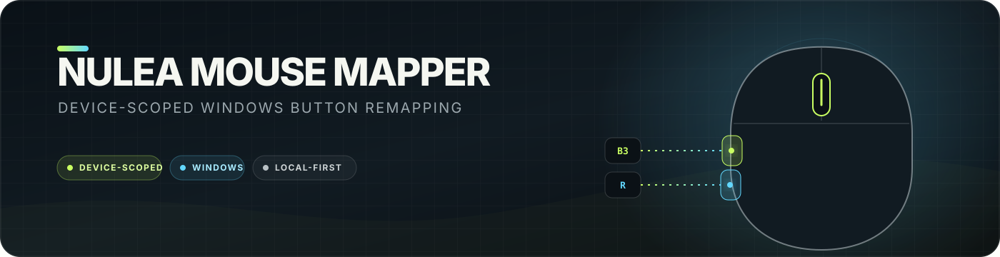

<p align="center">
  
</p>

<p align="center">
  A local-first toolkit for identifying and remapping buttons on one physical Nulea mouse without changing other connected mice.
</p>

<p align="center">
  <a href="LICENSE"></a>
  
  
</p>

> [!CAUTION]
> Device-specific blocking requires the unsigned Interception input-filter driver. Driver problems can temporarily disable mouse or keyboard input until Windows is restarted. Read the safety notes before installing it.

## Current mapping

| Nulea input | Result |
|---|---|
| Physical right button | Disabled |
| Back side button | Right-click |
| Every other button and wheel input | Unchanged |

The mapping is deliberately **not** enabled at Windows startup. It must be identified and tested interactively first, and it affects only the selected physical device handle.

## What is included

- **Button Lab** — a dependency-free browser interface that identifies standard mouse button codes and records a mapping plan.
- **Device discovery** — a non-blocking AutoHotInterception utility that captures the exact physical Nulea device.
- **Nulea mapper** — blocks the physical right button and converts the Back side button into a complete right-button down/up sequence.
- **Pinned setup** — downloads official upstream releases and checks their SHA-256 hashes before assembling a local runtime.
- **Recovery controls** — another connected mouse remains unaffected, and `Ctrl+Alt+Shift+F12` exits the mapper immediately.

Third-party archives, binaries, generated runtime files, and personal device handles are excluded from Git.

## Requirements

- Windows 10 or 11, 64-bit
- PowerShell 5.1 or later
- Node.js for Button Lab
- Administrator access only if you decide to install or remove the Interception driver
- A second working mouse is strongly recommended during initial testing

## Prepare the local runtime

From PowerShell in the repository root:

```powershell
.\scripts\setup.ps1
```

This downloads portable AutoHotkey 2.0.30, AutoHotInterception 0.9.2, and Interception 1.0.1 from their official GitHub releases. It verifies pinned checksums and creates `.runtime/`. It does **not** install a driver or activate a mapping.

## Use Button Lab

```powershell
npm run button-lab
```

Open <http://127.0.0.1:8765>, press each Nulea button inside the test area, select the desired actions, and save the plan. The plan is written to `button-lab/mapping-plan.json`, which is ignored by Git.

## Enable device-scoped mapping

Only proceed after reviewing the driver warning below.

1. Open an elevated PowerShell window and run:

   ```powershell
   .\scripts\install-driver.ps1
   ```

2. Restart Windows.
3. Identify the Nulea device:

   ```powershell
   .\.runtime\AutoHotkey64.exe .\.runtime\DiscoverNulea.ahk
   ```

   Use only the Nulea mouse, press one of its buttons, then press `F8`. The selected device handle is saved locally in `.runtime/nulea-device.txt`.

4. Start the mapper:

   ```powershell
   .\.runtime\AutoHotkey64.exe .\.runtime\NuleaMapper.ahk
   ```

5. Test the physical right and Back side buttons. The mapper is not added to startup automatically.

## Stop or recover

- Press `Ctrl+Alt+Shift+F12` to exit the mapper immediately.
- Or use its tray menu and choose **Exit and restore normal buttons**.
- If the mapper exits or crashes, subscriptions disappear and the mouse returns to its native behavior.
- Keep another connected mouse available during the first test.

To remove the driver, run the following from an elevated PowerShell window, then restart Windows:

```powershell
.\scripts\uninstall-driver.ps1
```

## Driver warning

AutoHotInterception warns that blocking occurs below normal Windows input handling and can lock input when scripts target the wrong device or key. Its documented device-ID exhaustion issue can also require a restart after repeated disconnects or sleep cycles. The underlying Interception project lists testing through Windows 10; Windows 11 compatibility should therefore be treated as best-effort.

This project reduces the risk by:

- discovering the device without blocking anything;
- saving and resolving the physical device handle instead of hard-coding a transient Interception ID;
- subscribing to only two button codes on one mouse;
- never blocking movement, left click, the keyboard, or every attached device;
- keeping startup integration out of scope until manual testing succeeds.

## Dependency provenance

| Dependency | Version | Upstream |
|---|---:|---|
| AutoHotkey | 2.0.30 | <https://github.com/AutoHotkey/AutoHotkey> |
| AutoHotInterception | 0.9.2 | <https://github.com/evilC/AutoHotInterception> |
| Interception | 1.0.1 | <https://github.com/oblitum/Interception> |

Exact archive URLs and SHA-256 values live in [`scripts/setup.ps1`](scripts/setup.ps1).

See [`THIRD_PARTY_NOTICES.md`](THIRD_PARTY_NOTICES.md) for license provenance and the Interception project's separate commercial-licensing note.

## Development

```powershell
npm run check
node --check button-lab/server.js
```

The Button Lab has no package dependencies and can also be opened directly as a static HTML file, although saving its plan to disk requires the local Node server.

Contributions are accepted through pull requests. See [`CONTRIBUTING.md`](CONTRIBUTING.md) for scope and safety requirements. Security issues should follow [`SECURITY.md`](SECURITY.md) and must not be disclosed in a public pull request.

## License

Project-authored code and assets are licensed under the [MIT License](LICENSE); downloaded dependencies retain their upstream licenses.

Nulea and M505 are used solely for hardware identification. This community project is not affiliated with or endorsed by Nulea.
